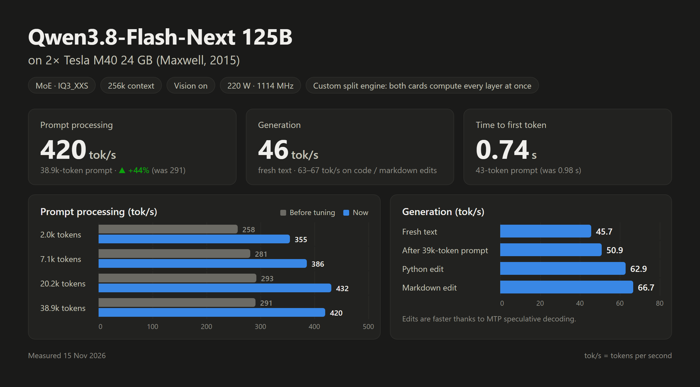

# Two Tesla M40 24 GB: a test build

> **TEST BUILD, measured on one machine only.** We ran this engine on our second server, two **Tesla M40 24 GB**
> (Maxwell, sm_52, 2015), from 6 November 2026 until we sold that server. Every number below is from that machine. The
> server is gone, so we cannot measure anything again or test a fix. The sources in [`engine-m40/`](../engine-m40/README.md)
> are those of the binary we ran, put together again from our files on 20 Nov 2026 and **not compiled again since**.
> Only the **24 GB** M40 was run (the 12 GB one has no room for this memory plan).

Qwen3.8-Flash-Next (ISTA-DASLab's GSQ-RCO IQ3_XXS) with a 256k context and pictures, on two M40 24 GB and **32 GB of RAM**:

| ✍️ Fresh writing | ✏️ Edits (Python / Markdown) | 📖 Read 38,862 tokens | Writing after that read | ⏱️ First answer to a 43-token prompt |
|---:|---:|---:|---:|---:|
| **45.7 tok/s** | **62.9 / 66.7 tok/s** | **420 tok/s** | 50.9 tok/s | 0.74 s |



It is the same kind of engine as the P100 release (Strata's split engine from sFNX: both cards work on every layer at
once, the experts that do not fit stream in from RAM), with kernels of its own for Maxwell, which has no f16 arithmetic.
It is a separate tree because it was made from the P100 sources of 6 Nov ([engine-m40/README.md](../engine-m40/README.md)).

## Quick start

You need Linux, two Tesla M40 24 GB, 32 GB of RAM with some swap, and CUDA 12.x (12.4 here; CUDA 13 has no sm_52).

```bash
git clone -b m40-2x https://github.com/Megla123/Scream-P100.git && cd Scream-P100
bash build.sh --m40                            # engine-m40/ for sm_52 into build-m40/
bash setup.sh /data/flash-next-m40 --model iq3_xxs   # Strata v0.2.9, the IQ3_XXS (76 GB), tokenizer, MTP layer, pictures, run config
bash run.sh /data/flash-next-m40               # OpenAI-compatible API on http://127.0.0.1:8080/v1 after about 4 minutes
```

- `--model iq3_xxs` downloads ISTA-DASLab's IQ3_XXS at the revision Strata pins (both shards checked against SHA-256). Its second
  shard is the same file as the IQ3_S's second shard: with the IQ3_S already downloaded, hard-link it under the IQ3_XXS name.
- ⚠️ **Never build while the engine is loaded**, and on a 32 GB machine never beside anything big: the engine fills the RAM.
- The run config is `profile/flash-next-iq3xxs-m40-256k.template.json` filled in by `setup.sh`; its settings are the ones we
  ran (below). The `STRATA_*` variables in our old config were for Strata's own engine and are left out (this engine reads none).

## Our machine

| | |
|---|---|
| Server | HPE ProLiant DL380 Gen10, 2 × Xeon Bronze 3106 (8 cores, 1.7 GHz) |
| RAM | 32 GB DDR4-2133, one 16 GB module per CPU (Linux sees 30 GiB), 8 GiB swap file |
| GPUs | 2 × Tesla M40 24 GB (sm_52, 24 SMs, 288 GB/s), each in its own PCIe 3.0 x16 slot on its own CPU, BAR1 32 GiB |
| Power and clocks | power limit **220 W** a card, application clocks **3004 / 1114 MHz** (`nvidia-smi -ac 3004,1114`; default 947 MHz); the cards on an external 750 W supply |
| Disk | a 256 GB SSD (the model loads at about 0.54 GB/s) |
| Software | Ubuntu 26.04, kernel 7.0, NVIDIA 580, CUDA 12.4, gcc 13, Strata v0.2.9's server, `iommu=pt` |

## Speed

Our own test chain (not `bench/bench.py`), one run per test; in the 15 Nov rounds each arm started with the model's files
dropped from the page cache. Fresh writing is the mean of 12 requests; edits are the third run of a Python (1,388 tokens) and a Markdown (1,224 tokens)
edit; reads are new prompts of the given length, in seconds or tok/s.

**15 Nov 2026, from the engine of 6 Nov to the one in this branch** (each column adds to the one before):

| Test | 6 Nov engine | + P100 prompt changes | + new prompt kernel (`FNX_M40_PF`) | + cuBLAS algorithms | **+ 1114 MHz, 220 W** |
|---|---:|---:|---:|---:|---:|
| Read 38,862 tokens (tok/s) | 290.7 | 311.3 | 365.5 | 398.7 | **420.2** |
| Writing after it (tok/s) | 47.8 | 50.1 | 49.6 | 49.8 | 50.9 |
| Read 2,029 / 7,142 / 20,243 tokens (s) | 7.87 / 25.4 / 69.2 | 7.75 / 24.9 / 63.5 | 6.49 / 21.4 / 54.0 | 5.99 / 19.7 / 49.6 | **5.72 / 18.5 / 46.9** |
| Start of a conversation, 18,563 tokens (s) | 60.1 | 55.8 | 47.0 | 42.8 | **40.4** |
| Next turn, +226 / +757 new tokens (s) | 1.74 / 3.46 | 1.74 / 3.43 | 1.33 / 2.80 | 1.31 / 2.68 | **1.30 / 2.64** |
| Fresh prompt of 43 / 93 / 216 tokens (ms) | 984 / 1,174 / 1,714 | 978 / 1,174 / 1,716 | 761 / 923 / 1,337 | 777 / 976 / 1,325 | **744 / 925 / 1,314** |
| Fresh writing (tok/s) | 44.98 | 44.74 | 45.24 | 44.89 | **45.74** |
| Edits, Python / Markdown (tok/s) | 62.1 / 66.2 | 62.5 / 66.2 | 62.8 / 66.6 | 62.8 / 66.6 | **62.9 / 66.7** |

The first four columns ran at 947 MHz and 200 W (the cuBLAS column's short reads already at 220 W).

**6 Nov 2026, against what the M40 ran before:** Strata v0.2.9's layer-split engine (one card waits while the other works)
with our sm_50 changes, on the same file and machine:

| Test | Strata v0.2.9 (layer split) | This engine on 6 Nov |
|---|---:|---:|
| Fresh writing | 35.2 tok/s | 44.3 tok/s (+26 %) |
| Edits, Python / Markdown | 41.1 / 41.8 tok/s | 62.4 / 66.2 tok/s (+52 / +58 %) |
| Read 38,862 tokens / writing after it | 274.8 / 34.4 tok/s | 292.3 / 50.2 tok/s |
| A picture: first answer / writing after it | 3.3 s / 24.3 tok/s | 2.9 s / 36.4 tok/s |
| Start of a conversation, 18,563 tokens | 70.3 s | 58.8 s |

**Answers:** this engine is not bit-exact with Strata's. First-token logits against the layer-split engine on 6 Nov: KL mean
0.0053, at most 0.016, the same first token in 8 of 9 requests (the ninth had two nearly equal candidates). On 15 Nov against
the 6 Nov engine: the P100 changes KL 0 (45 of 45), the new prompt kernel and the cuBLAS algorithms KL mean 0.0037, at most
0.038, the same first token in 44 of 45. Rounding level; the clock changes no bits. A test picture was described correctly
and a 102,003-token ban list (no CJK script) worked in every column.

## The model

ISTA-DASLab's [Qwen3.8-Flash-Next-GSQ-RCO-GGUF](https://huggingface.co/ISTA-DASLab/Qwen3.8-Flash-Next-GSQ-RCO-GGUF), folder
`IQ3_XXS` at revision `ed59f92` (the one Strata pins): 47.0 GB + the 28.8 GB lookup table. "IQ3_XXS" is a mixture:

| Part | Types (layers) | GiB |
|---|---|---:|
| experts' gate and up | IQ3_S (13), IQ2_S (10), IQ2_XS (10), IQ2_XXS (9), IQ3_XXS (6) | 2 × 12.73 |
| experts' down | IQ4_NL (18), Q2_0 = Strata's type 42 (30) | 14.50 |
| attention and GDN | Q6_K, BF16, IQ4_XS, Q4_K, Q5_K, IQ3_S | 2.24 |
| `hc`, embedding, output | BF16, IQ3_S, Q5_K | 1.48 |
| lookup table (second shard) | IQ4_NL | 26.8 |

Only this file was run on the M40. Its experts: 14,992 pinned on the cards (24.0 GiB), 6,670 that can move (11.0 GiB, with a
RAM copy), 2,914 in RAM only (5.0 GiB, the coldest); the cards serve about 99.8 % of the picks while writing. The K/V pool has
129,408 positions of its own and reaches 262,464 by borrowing expert slots; about 300 MiB of VRAM a card stays free.

## Settings that matter on the M40

All are in the template; they differ from the P100's:

- **`--lookup 3`** (P100: 15): a 16-row window costs about three times an 8-row one on the M40, and windows over 4 rows did
  not pay. Edits with 15: 39.5 / 40.7 tok/s; with 7: 54.4 / 57.0; with 3: 62.6 / 66.2.
- **`FNX_READ_WINDOWS=32`** (P100: 144): prompts of more than 32 tokens go through the prompt path.
- **`FNX_EXPERT_RAM_GIB=5`, `FNX_EXPERT_DYN_GIB=11`, `FNX_PLE_RAM=0`**: the 32 GB plan. The load peaks with about 4 GiB free
  and 1.8 GB of swap in use, and leaves about 10 GiB free once loaded (load: about 220-230 s).
- **`FNX_M40_PF=1`, `FNX_M40_HC_ALGO=1`, `FNX_M40_DENSE_ALGO=1`**, with `FNX_PF_SP`, `FNX_PF_PREP`, `FNX_QSA_TILE`,
  `FNX_QSA_SEL`: the 15 Nov reading changes. `FNX_PF_F16ACC=0`: sums in f32.
- **Clocks and power** are not in the profile: `nvidia-smi -ac 3004,1114` and a 220 W limit gave +4-6 % on reads. At 230 W
  with both cards at full power our server froze once, so we stayed at 220 W.

Does **not** work on Maxwell or did not pay: `FNX_PF_GDN_CHUNK=1` (needs more than 48 KB of shared memory a block),
`FNX_PF_STAGE_ALL` (out of memory; with a smaller stage no gain), the picture encoder on a card (no VRAM left: it runs on
the CPU), `FNX_M40_LPR=5` (more threads per row in the writing kernel: faster alone, no gain in the engine), `FNX_DRAFT_MIN_P=0.85`
(−4 %). `FNX_FOLD` and the P100's later writing changes were never brought over.

## Requirements and limits

- **Linux x86-64, two Tesla M40 24 GB** (compute capability 5.2), **Above 4G Decoding** (each card needs its BAR1), and on
  Intel boards with VT-d **`iommu=pt`**.
- **32 GB of RAM** plus swap (ours: 8 GiB), and an SSD for the model (the lookup table is read from the file).
- **CUDA 12.x** with a host compiler it accepts (12.4: gcc 13 at most), a driver for both CUDA 12 and Maxwell (580 here),
  CMake 3.22+, git, Python 3.10+. About 90 GB of disk during setup: 77 GB of model files with the picture projector, the MTP
  layer, and 6 GB of its intermediate files, which can be deleted afterwards.
- One request at a time, 262,144 positions at most (512k was not tried), the first requests after a load are slower while the
  lookup table comes into the page cache.
- **Not tested:** any other machine, any other model file, more than two cards, this tree compiled again, the kernel checks in
  `engine-m40/tests/` since 15 Nov. If you run it, an issue with `nvidia-smi`, the load log and your numbers is welcome.

## Credits

[Strata](https://github.com/Niko1221/Strata) by Niko1221 and contributors, and John Fink's [sFNX](https://github.com/johnfink8/sfnx),
whose split engine Strata ported; ggml / llama.cpp block formats; ISTA-DASLab's GSQ-RCO model files; Qwen's Qwen3.8-Flash-Next.
See [NOTICE.md](../NOTICE.md).
